# Data Science Cheat Sheets


Small, printable HTML pages covering the fundamentals of data science and ML interviews.
Open [`index.html`](index.html) in a browser to browse everything, or jump straight to a sheet below.

<p align="center">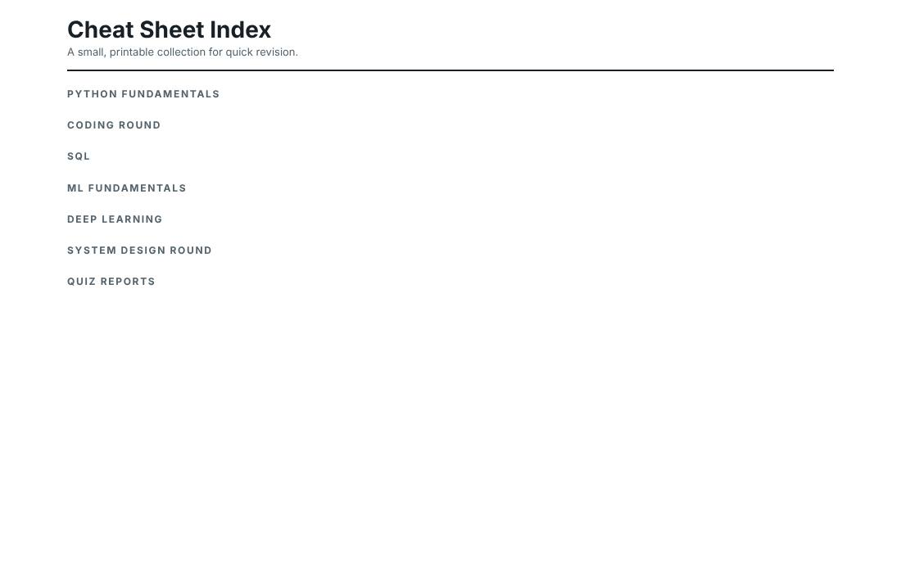</p>

## Map of the sheets

The sheets are grouped by interview stage, the same way the index page groups them.

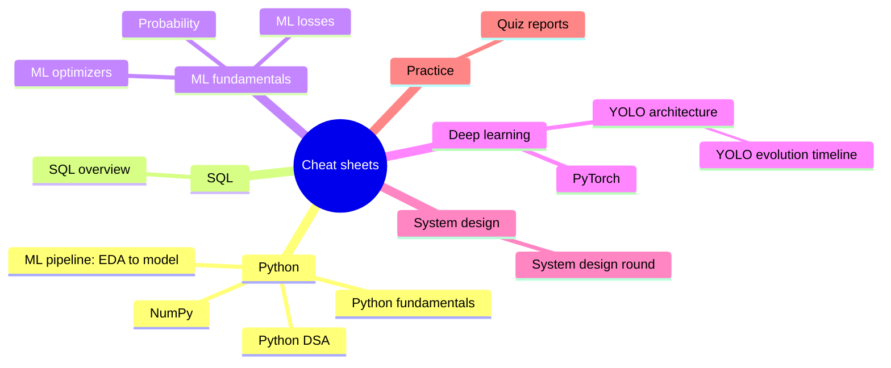

## Sheets

| Stage | Sheet | What it covers |
| --- | --- | --- |
| 🐍 Python | [Python fundamentals](sheets/python-fundamentals.html) | Python fundamentals overview |
| 🧩 Coding round | [Python DSA](sheets/python-dsa-data-structures-cheatsheet.html) | Quick syntax, common moves and interview traps |
| 🧩 Coding round | [NumPy](sheets/numpy-basics-cheatsheet.html) | Creating, reshaping, indexing, math and combining arrays |
| 🧩 Coding round | [ML pipeline](sheets/ml-pipeline-cheatsheet.html) | Timed EDA → preprocess → model round: lines to remember |
| 🗄️ SQL | [SQL](sheets/sql-cheatsheet.html) | `CASE WHEN`, joins, grouping, clause order, CTEs, window functions |
| 📐 ML fundamentals | [Probability](sheets/probability-cheatsheet.html) | Conditional probability, Bayes theorem, random variables |
| 📐 ML fundamentals | [ML optimizers](sheets/ml-optimizers-cheatsheet.html) | Core formulas, what each optimizer adds, and when it appeared |
| 📐 ML fundamentals | [ML losses](sheets/ml-losses-cheatsheet.html) | Picking a loss for the task, target structure and errors you care about |
| 🧠 Deep learning | [PyTorch](sheets/pytorch-cheatsheet.html) | Update rule, batch vs mini-batch, training loop, a small CNN |
| 🧠 Deep learning | [YOLO architecture](sheets/yolo-architecture-cheatsheet.html) | Major architectural shifts from YOLOv1 to YOLO26 |
| 🧠 Deep learning | [YOLO evolution](sheets/yolo-architecture-evolution.html) | Interactive YOLO architecture timeline |
| 🏗️ System design | [System design](sheets/system-design-cheatsheet.html) | Requirements, scaling, storage, reliability and trade-offs |
| 📝 Practice | [Quiz reports](quizzes/quiz-reports.html) | Python MCQ quiz history with strengths and weaknesses |

## Previews

<table>
  <tr>
    <td align="center"><a href="sheets/yolo-architecture-evolution.html">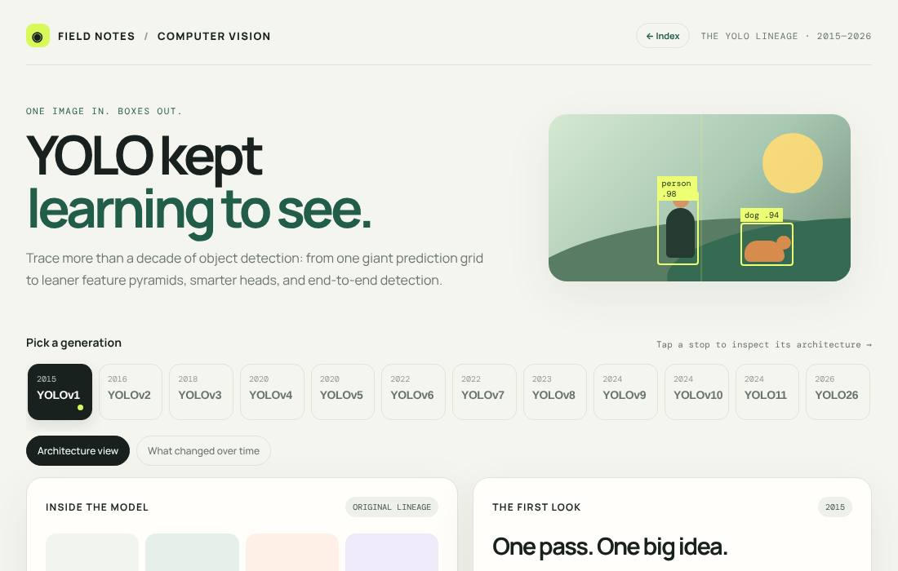</a><br><sub>YOLO evolution</sub></td>
    <td align="center"><a href="sheets/ml-pipeline-cheatsheet.html">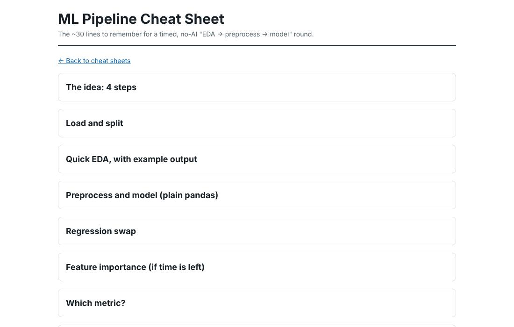</a><br><sub>ML pipeline</sub></td>
  </tr>
  <tr>
    <td align="center"><a href="sheets/ml-optimizers-cheatsheet.html">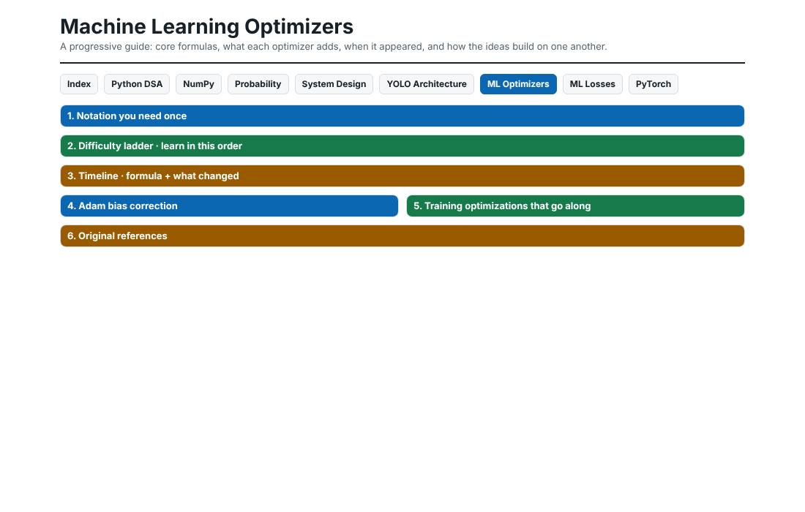</a><br><sub>ML optimizers</sub></td>
    <td align="center"><a href="sheets/pytorch-cheatsheet.html">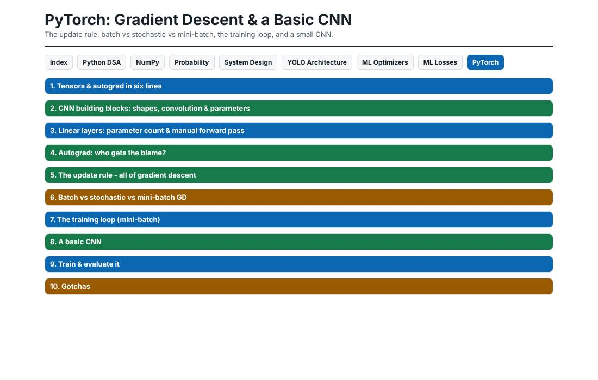</a><br><sub>PyTorch</sub></td>
  </tr>
</table>

<details>
<summary>More previews</summary>

| | |
| --- | --- |
| 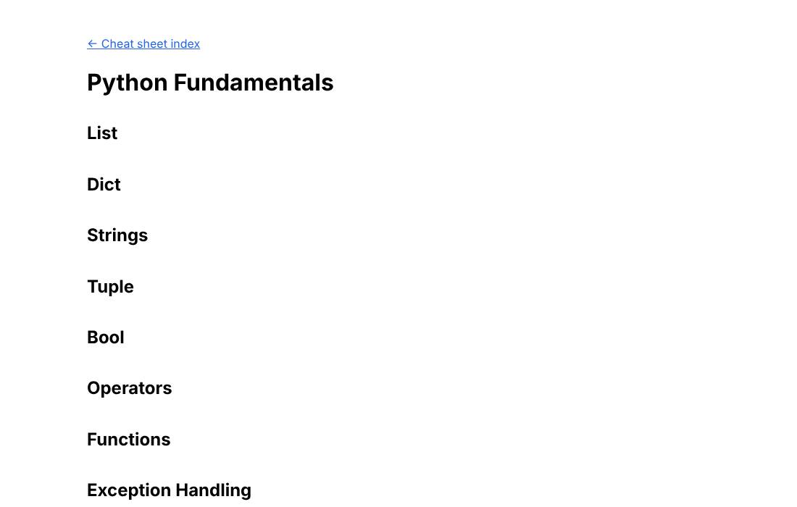<br><sub>Python fundamentals</sub> | 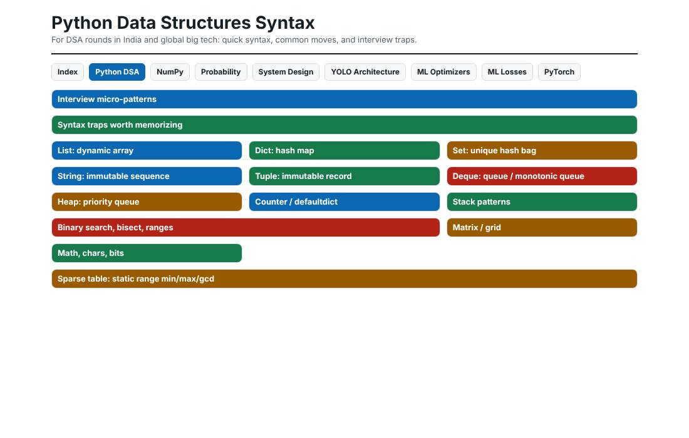<br><sub>Python DSA</sub> |
| 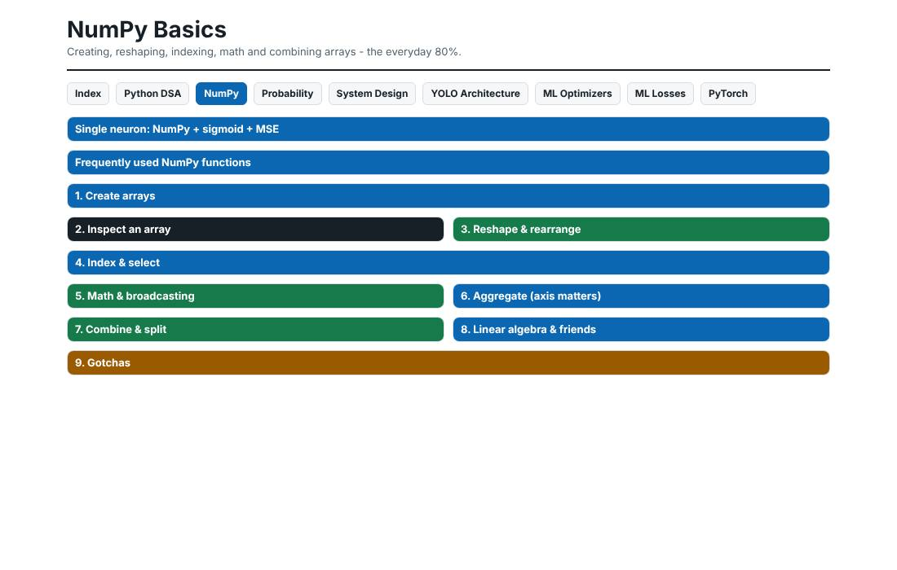<br><sub>NumPy</sub> | 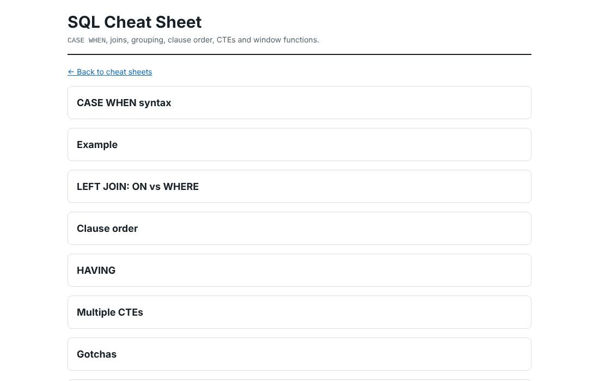<br><sub>SQL</sub> |
| 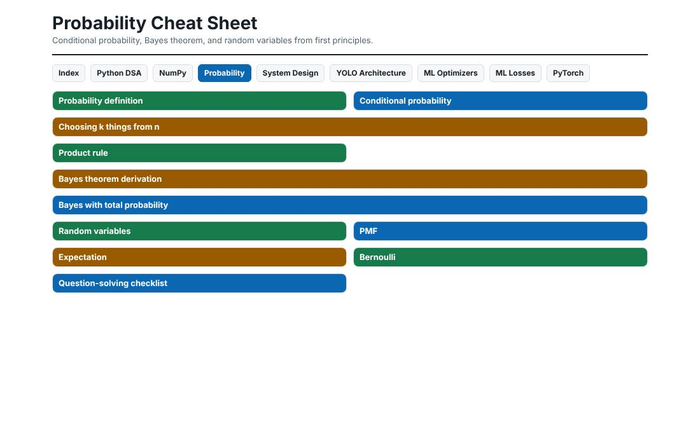<br><sub>Probability</sub> | 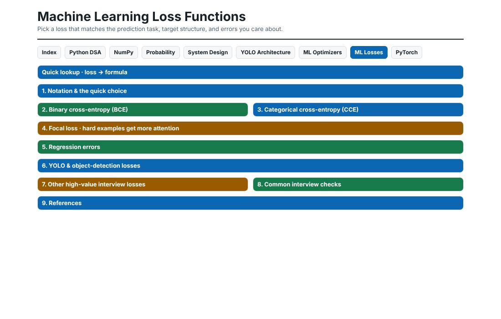<br><sub>ML losses</sub> |
| 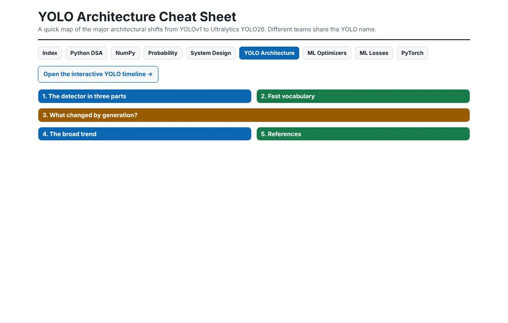<br><sub>YOLO architecture</sub> | 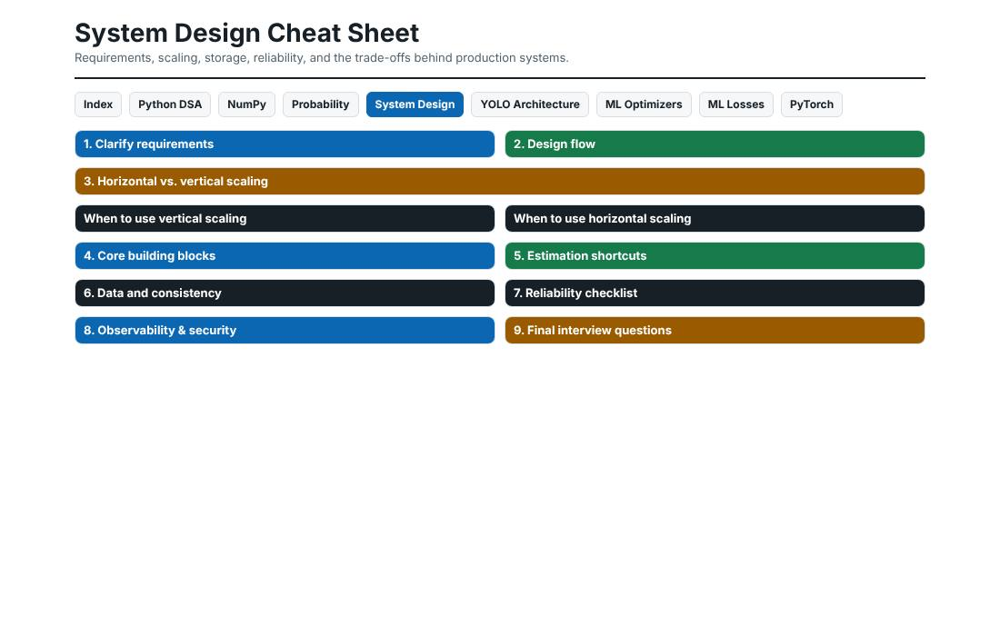<br><sub>System design</sub> |
| 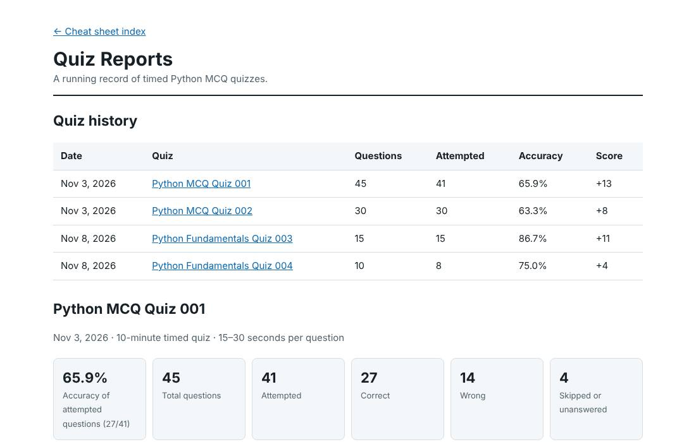<br><sub>Quiz reports</sub> | |

</details>

## Repository layout

```text
.
├── index.html          # entry point: grouped index of every sheet
├── sheets/             # one self-contained HTML page per topic
├── quizzes/            # quiz history and per-quiz reports
├── assets/
│   ├── images/         # figures embedded in the sheets
│   └── previews/       # screenshots used in this README
├── AGENTS.md           # maintenance rules for quizzes and reports
└── README.md
```

## Adding a sheet

1. Create `sheets/<topic>-cheatsheet.html`. Link back with `href="../index.html"` and put images in `assets/images/` (referenced as `../assets/images/...`).
2. Add it to the right stage in [`index.html`](index.html) as `sheets/<topic>-cheatsheet.html`.
3. Add a row to the table above and a node to the map.
